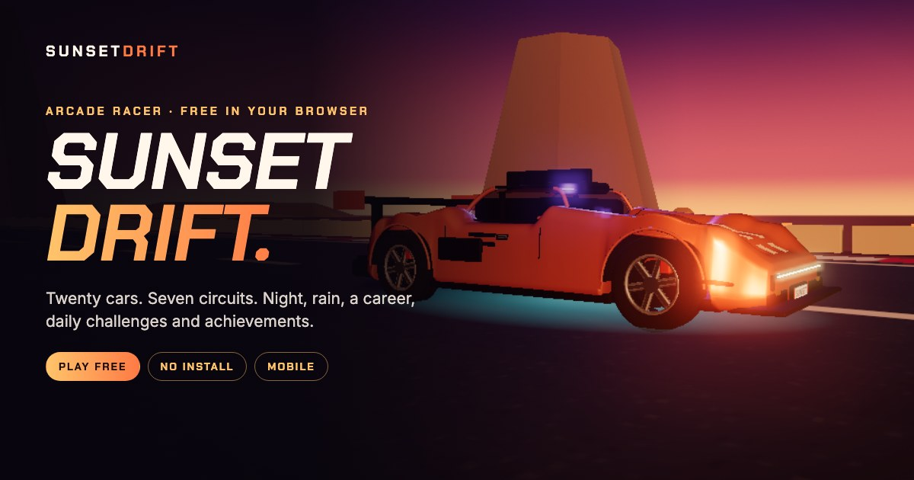
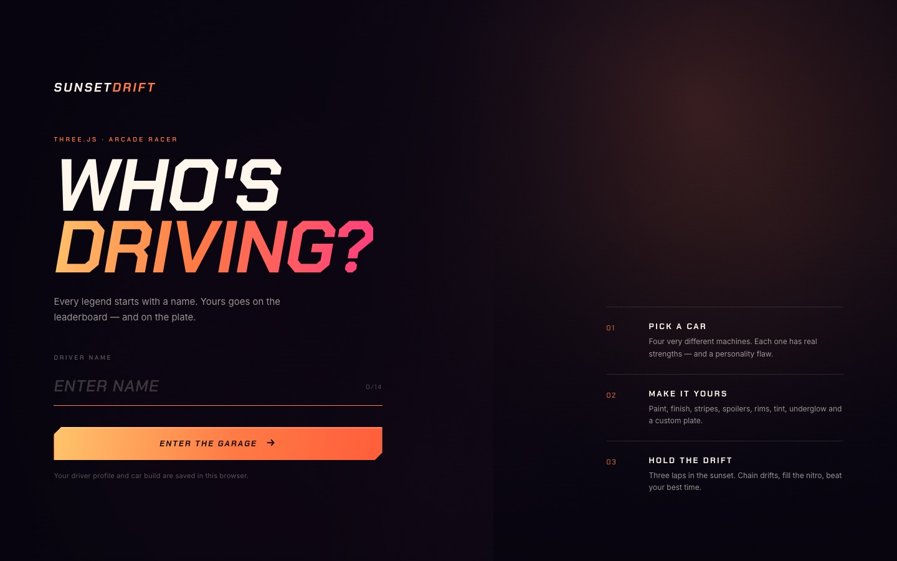
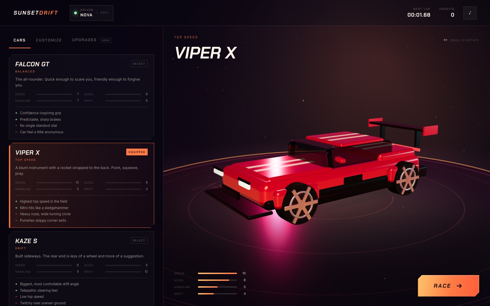
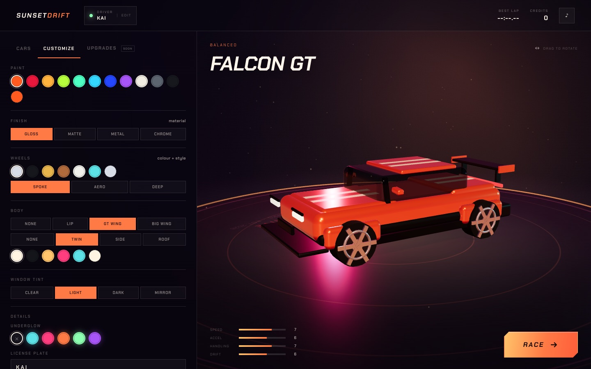
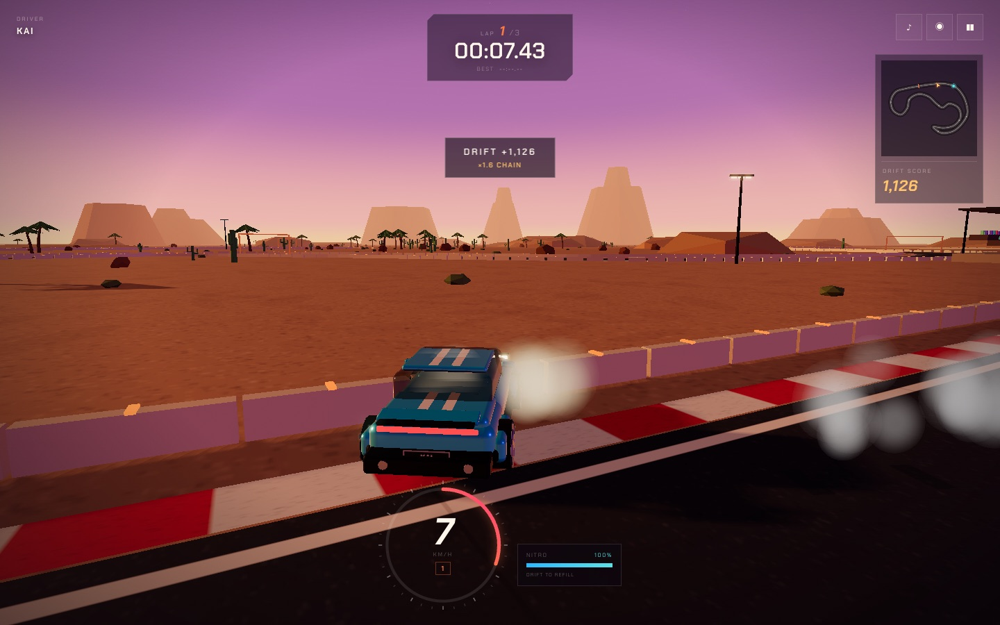
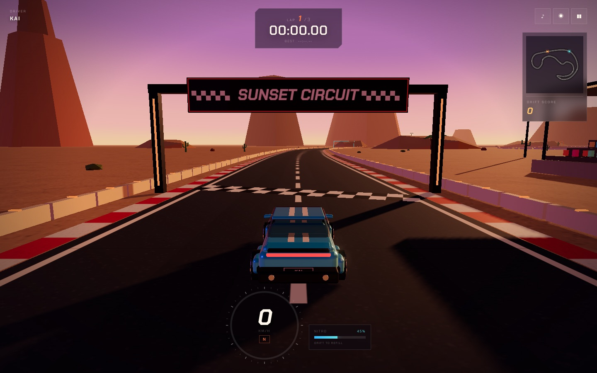
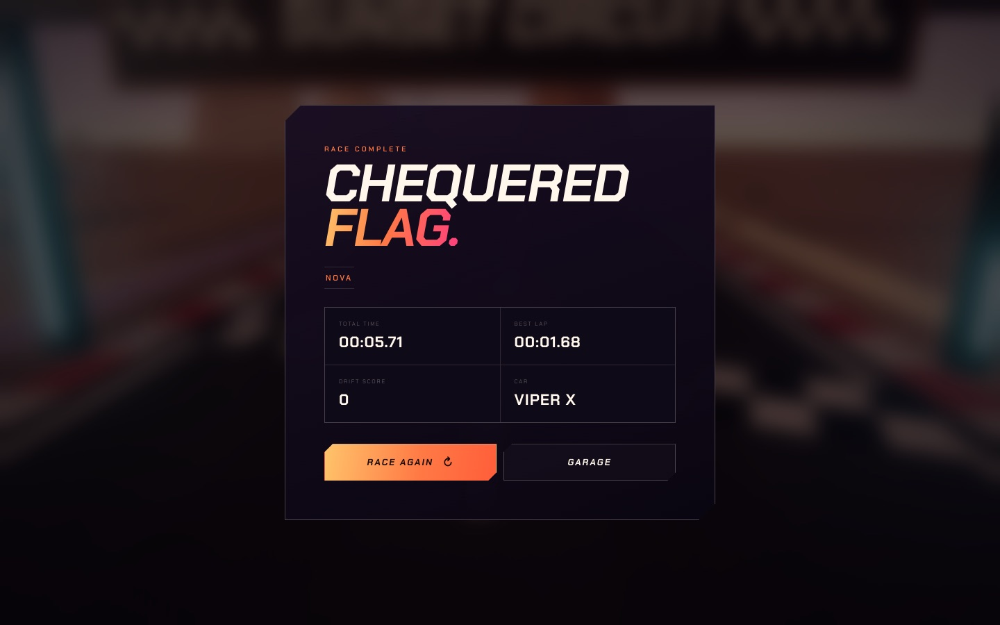

<div align="center">
  
</div>

# Sunset Drift

**A browser-native arcade drift racer.** Pick a driver name, choose one of four
very different cars, build a look, then chase the sunset across three laps of a
procedural desert circuit.

No install. No account. No build step.

[](https://github.com/ybenbrai/cars/actions/workflows/ci.yml)
[](https://github.com/ybenbrai/cars/actions/workflows/deploy-pages.yml)
[](LICENSE)
[](https://threejs.org/)
[](.nvmrc)

[Play the demo](https://ybenbrai.github.io/cars/) · [Gameplay guide](docs/GAMEPLAY.md) · [Architecture](docs/ARCHITECTURE.md) · [Deploy](docs/DEPLOYMENT.md)

---

## The game

Sunset Drift is a compact arcade racer built around a simple idea: make drifting
feel good immediately, but leave enough depth to chase a clean lap.

- **Eighteen cars across eight classes.** Hatchbacks to hypercars, each with its
  own body, stats, price and rank requirement. Start with 30,000 CR and earn
  your way up.
- **A real garage.** Change paint, finish, rims, spoiler, stripes, tint,
  underglow and the license plate with a live 3D preview.
- **Seven circuits, four modes.** Career (nine events), Quick Race against up to
  seven AI rivals on four difficulty levels, Time Trial and Practice. Practice
  opens every circuit; locked ones are rented per session. Practice also has a
  dedicated airport-style test runway: a 3.6 km straight for top-speed runs.
- **Online races.** Quick match or private rooms with a share code, up to six
  drivers, live positions and server-ranked results (needs the bundled server
  and an account).
- **Arcade drift physics.** Handbrake rotation, slip angle, combo scoring,
  nitro refills, off-road penalties and wall collisions.
- **Plays everywhere.** Keyboard, gamepad and on-screen touch controls.
- **Procedural everything.** Track, cars, scenery, textures, particles and audio
  are generated at runtime — the repository ships no model, texture or sound
  files.

## Play

### Live demo

**<https://ybenbrai.github.io/cars/>**

> The demo goes live after the
> [Deploy to GitHub Pages](https://github.com/ybenbrai/cars/actions/workflows/deploy-pages.yml)
> workflow runs. See [docs/DEPLOYMENT.md](docs/DEPLOYMENT.md) for the one-time setup.

### Locally

```bash
git clone git@github.com:ybenbrai/cars.git
cd cars
npm start
```

Open <http://localhost:5173>. Node.js 18+ is required; Node 20 is used in CI.

The first load needs internet access for Three.js (jsDelivr) and the UI fonts
(Google Fonts). Opening `index.html` through `file://` will not work because the
game uses ES modules and an import map.

## Screenshots

| Driver profile | Garage |
| --- | --- |
|  |  |
| **Customization** | **Race** |
|  |  |
| **Countdown** | **Results** |
|  |  |

## Controls

| Action | Keyboard | Gamepad | Touch |
| --- | --- | --- | --- |
| Accelerate | `W` / `↑` | RT / A | GAS |
| Brake / reverse | `S` / `↓` | LT / X | BRK |
| Steer | `A` `D` / `←` `→` | Left stick | ◀ ▶ |
| Handbrake / drift | `Space` | LB / RB | DRIFT |
| Nitro | `Shift` | B | N2O |
| Cycle camera (near chase, far chase, bumper, cockpit) | `C` | Y | — |
| Look back | Hold `B` | — | — |
| Pause / resume | `Esc` / `P` | Start | ❚❚ |
| Reset to track | `R` | — | — |
| Mute | `M` | — | ♪ |

Touch controls appear automatically on coarse-pointer devices. They are built
for landscape: phones are asked to rotate (and locked where the browser allows
it), with light, see-through steering and pedal buttons in the corners. The
game pauses itself when the tab loses visibility.

## Cars

| Car | Class | Strength | Trade-off |
| --- | --- | --- | --- |
| **FALCON GT** | Balanced | Confidence-inspiring grip and predictable brakes | No single standout stat |
| **VIPER X** | Top speed | Highest top end and the hardest-hitting nitro | Heavy nose, wide turning circle |
| **KAZE S** | Drift | Biggest, most controllable drift angle | Low top speed, twitchy over bumps |
| **COMET RS** | Launch | Fastest launch and nimble in tight complexes | Lacks top-end legs, light rear |

Full stats, physics modifiers, scoring formulas and driving tips are in the
[gameplay guide](docs/GAMEPLAY.md).

## Features

**Driving and racing**

- Fixed 120 Hz arcade physics with handbrake drift, grip loss, off-road drag and
  wall collisions
- Three-lap time attack with ordered checkpoint gates and finish-line banking
- Drift score with a time-based combo multiplier up to ×5
- Nitro that refills through drifting, checkpoints, laps and track pickups
- Best-lap persistence, wrong-way detection and a live minimap

**Online multiplayer**

- WebSocket lobby built into `server.mjs` (no dependencies): quick match into
  public rooms, private rooms with a five-character code, host-picked circuit
  and lap count, ready checks and rematches
- Remote cars are interpolated between snapshots and collide with yours
- Finishing order comes from the server clock; implausibly fast finishes are
  rejected
- Requires a signed-in account; static hosts show an explanation instead

**Garage**

- Four cars with stats, pros and cons derived from real handling modifiers
- Live 3D turntable with drag-to-rotate
- Paint, finish, rim color/style, spoiler, stripes, tint, underglow and plate
- Per-car looks and a profile that survives reloads

**Presentation**

- Procedural sunset environment with mesas, palms, grandstands, light towers
  and a sun-shadow camera that follows the player
- ACES tone mapping, bloom, soft shadows and speed-sensitive camera FOV
- Skid marks, tire smoke, dust, sparks and nitro flames
- Procedural engine, tire, wind, impact and UI audio, plus a synthwave menu
  soundtrack generated live with Web Audio

**Engineering**

- Zero runtime dependencies beyond CDN-loaded Three.js
- Zero-dependency static dev server with MIME, HEAD and path-traversal handling
- Unit tests for the server and car data, project checks and reproducible build
- GitHub Actions CI and GitHub Pages deployment

## Tech stack

| Layer | Choice |
| --- | --- |
| Rendering | [Three.js](https://threejs.org/) `0.169.0` via CDN import map |
| Post-processing | `EffectComposer`, `UnrealBloomPass`, `OutputPass` |
| Language | Vanilla JavaScript ES modules |
| UI | Semantic HTML + CSS, no framework |
| Audio | Web Audio API synthesis |
| Persistence | `localStorage` |
| Dev server | Node.js `node:http` (`server.mjs`) |
| Tests | Node.js `node:test` |
| CI/CD | GitHub Actions → GitHub Pages |

## Project structure

```text
.
├─ index.html                 Screens, HUD, import map and metadata
├─ styles.css                 Sunset theme, HUD and responsive layouts
├─ manifest.webmanifest       Installable web app metadata
├─ server.mjs                 Static server, accounts, cloud saves, online lobby
├─ server/
│  ├─ rooms.mjs               Online rooms, matchmaking and race flow
│  └─ ws.mjs                  Minimal RFC 6455 WebSocket endpoint
├─ js/
│  ├─ main.js                 State machine, race loop, camera, scoring
│  ├─ track.js                Circuit geometry, gates, nitro bottles, nearest-point lookup
│  ├─ scenery.js              Sky, lights, ground, mesas, grandstands, props
│  ├─ car.js                  Arcade physics, collisions, nitro
│  ├─ vehicleMath.js          Braking, coasting and drift math shared with tests
│  ├─ carModel.js             Procedural car mesh and cosmetics
│  ├─ garageScene.js          Garage turntable renderer
│  ├─ effects.js              Skid marks, particles, flames
│  ├─ audio.js                Procedural Web Audio engine and cues
│  ├─ input.js                Keyboard, gamepad and touch normalization
│  ├─ hud.js                  HUD updates and minimap canvas
│  ├─ ui.js                   Screen navigation, garage, race setup, online lobby
│  ├─ ai.js                   AI drivers and personalities
│  ├─ economy.js              Difficulty, payouts and rank progress
│  ├─ save.js                 Save store and progression
│  ├─ auth.js                 Account client (backend sessions, guest mode)
│  ├─ cloudSync.js            Versioned cloud-save sync
│  ├─ online.js               Multiplayer client and snapshot interpolation
│  └─ data/                   Cars, circuits and career events
├─ assets/                    Icon, social preview and generated favicon assets
├─ docs/                      Gameplay, architecture, testing, deployment, roadmap
├─ scripts/                   check.mjs and build.mjs
├─ tests/                     Node test runner suites
└─ .github/                   CI, Pages deployment, issue/PR templates
```

## Development

```bash
npm start          # serve the game at http://localhost:5173
npm run check      # syntax, JSON, local refs, import graph, CSS sanity
npm test           # server and car-data unit tests
npm run build      # create dist/
npm run preview    # build and serve dist/ locally
```

Node scripts:

| Script | Purpose |
| --- | --- |
| `scripts/check.mjs` | Project integrity checks used locally and in CI |
| `scripts/build.mjs` | Copies runtime files into `dist/` |
| `server.mjs` | Static server; accepts `PORT`, a positional root or `--root` |

### Debug hook

The browser console exposes `window.__sunsetDrift` with read-only getters for
`state`, `car`, `lap`, `nextGate` and `raceTime`, plus `track`, `scene`,
`camera` and `startRace()`. See [docs/TESTING.md](docs/TESTING.md).

## Documentation

| Document | Contents |
| --- | --- |
| [Gameplay guide](docs/GAMEPLAY.md) | Rules, cars, drift scoring, nitro, handling model, tips |
| [Architecture](docs/ARCHITECTURE.md) | Modules, state machine, fixed timestep, rendering, persistence |
| [Testing](docs/TESTING.md) | Automated checks, browser matrix, debug hook, release checklist |
| [Deployment](docs/DEPLOYMENT.md) | Local dev, production build, GitHub Pages, other hosts |
| [Roadmap](docs/ROADMAP.md) | Upgrades, new circuits and quality-of-life work |
| [Changelog](CHANGELOG.md) | Release history |
| [Contributing](CONTRIBUTING.md) | Setup, style, adding cars/cosmetics, PR checklist |
| [Code of Conduct](CODE_OF_CONDUCT.md) | Community expectations |
| [Security policy](SECURITY.md) | Private vulnerability reporting |

## Browser support

Sunset Drift targets current Chrome, Edge, Firefox and Safari with WebGL 2 and
hardware acceleration enabled. Gamepad support follows the browser's Gamepad
API. Performance is best on a desktop or laptop GPU; the renderer caps pixel
ratio and bloom resolution, but integrated GPUs may prefer a smaller window.

The UI is responsive and includes a dedicated touch layout, but the game is
designed for landscape orientation.

## Contributing

Contributions, bug reports and car ideas are welcome. Start with
[CONTRIBUTING.md](CONTRIBUTING.md), and please follow the
[Code of Conduct](CODE_OF_CONDUCT.md). Security issues should be reported
privately per [SECURITY.md](SECURITY.md).

## License

Code and generated assets are released under the [MIT License](LICENSE).
Three.js is © its contributors and used under the MIT License. Google Fonts are
served under their respective open font licenses.

## Credits

Designed and built as a self-contained Three.js project. Track layout, car
models, cosmetics, environment, effects and audio are all procedural. Thanks to
the Three.js community for the renderer, post-processing stack and documentation.
